<div align="center">

# MSKTerm

### SSH & Serial Terminal · SFTP · File Manager · Secure Vault · AI

**One tool for servers, network gear and serial consoles.**

MSKTerm is a Windows desktop application for everyday work. Connect to Linux servers over SSH, work with COM ports, transfer files over SFTP, edit configs, manage SSH keys and optionally ask an AI assistant in the same session — without constantly switching between programs.

**Version:** `0.1.12` · **Platform:** Windows 10 / 11 (x64) · **License:** free for non-commercial use

**[⬇ Download](https://github.com/msksrv/MSKTerm/releases/latest)** · **[Русский](README.md)**

</div>

> **MSKTerm combines a terminal, a file manager, an editor and an optional AI assistant.** It shines where plain SSH is not enough: configuring routers, working with UART consoles, maintaining servers behind bastion hosts, fixing configs with rollback and quickly diagnosing services from logs.

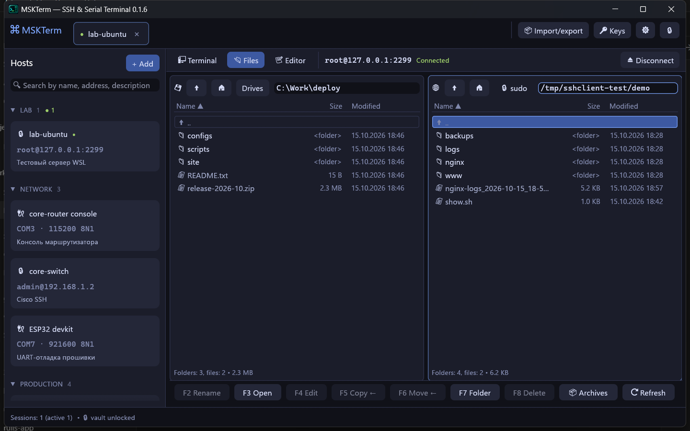

*The interface is available in English and Russian; most screenshots below show the Russian UI — the layout is identical.*

## Why MSKTerm

A typical workflow often needs several applications: an SSH client for the console, a separate program for the COM port, an SFTP client for files, an editor for configs and a utility for managing keys. MSKTerm brings these tasks together in one window with saved connections and tabs.

It is not just "a terminal with extra buttons". It covers scenarios that matter in real operations: SSH and USB-UART auto-reconnect without losing the tab, warnings when a remote file was changed, encrypted editor history, file access via sudo, chmod in the file manager, guided SSH key installation and BYO-key AI with secrets masked before they leave your PC.

## Download and run

1. Download `mskterm-0.1.12.exe` from the [releases page](https://github.com/msksrv/MSKTerm/releases/latest).
2. Verify the SHA-256 checksum (listed in the release notes):
   ```powershell
   Get-FileHash .\mskterm-0.1.12.exe -Algorithm SHA256
   ```
3. Run it. No installation needed — it is a single executable.
4. On first start choose a master password: it encrypts the vault with your connections, passwords and keys.

**Requirements:** Windows 10 or 11, 64-bit; a GPU with DirectX 12, Vulkan or OpenGL support (virtually any modern one).

**Where data is stored:** `%APPDATA%\SSHClient\config` — the encrypted `vault.bin`, known server keys, editor history, UI settings. To keep data elsewhere (e.g. on a USB stick next to the program), set the `SSHCLIENT_CONFIG_DIR` environment variable to the desired folder.

> The executable is not code-signed, so Windows SmartScreen may warn on first start. Verify the SHA-256 and click "More info → Run anyway".

## Features

### 1. Secure vault and master password

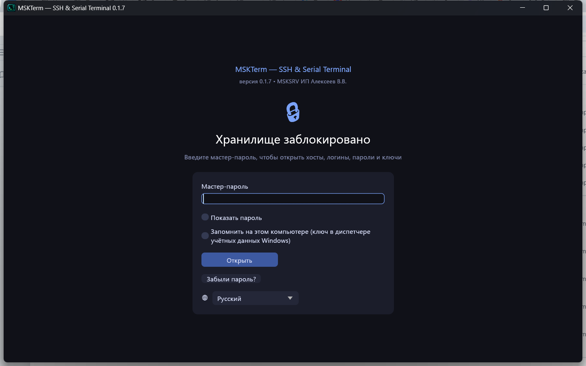

Passwords, connection settings and private SSH keys are stored in a single encrypted file, `vault.bin`.

| Component | Implementation |
|---|---|
| Encryption | XChaCha20-Poly1305 |
| Key derivation from the master password | Argon2id |
| Argon2id memory (default) | 64 MiB |
| Passes | 3 |
| Random salt | 16 bytes |
| Nonce | 24 bytes |
| Integrity | AEAD authenticated encryption |

- The master password is asked on start; the lock button in the top-right corner locks the vault at any time.
- Optionally the master password can be remembered in Windows Credential Manager so the vault opens without typing it on this computer.
- Change the master password in Settings. If writing the new vault fails, the old password keeps working.
- The editor history key is kept inside the vault separately, so changing the master password does not destroy version history.
- A forgotten master password cannot be recovered — "Forgot password?" offers to delete the vault and start over.

**Note:** encryption does not replace a strong master password and a protected computer. No independent cryptographic audit has been performed.

### 2. SSH client

- Password, private key or SSH agent authentication.
- Keys from the encrypted vault or from a file on disk; passphrase-protected keys are supported.
- **Windows OpenSSH Authentication Agent**, **PuTTY Pageant** and `SSH_AUTH_SOCK`.
- **Jump hosts / bastion hosts** like `ssh -J`, including chains.
- **Agent forwarding** (`ssh -A`).
- Server host key verification: explicit confirmation of a new key and a warning when the key has changed.
- Multiple sessions in tabs; hosts are grouped, with quick search by name, address and description.
- Disconnecting a hung session works immediately, even when the server stopped responding.
- **SSH auto-reconnect:** if the link drops, the tab stays open and retries with backoff (1→2→5→10→30 s). You can reconnect now, stop auto-retry, or disconnect explicitly without retries. Enter in a closed/waiting tab also reconnects.

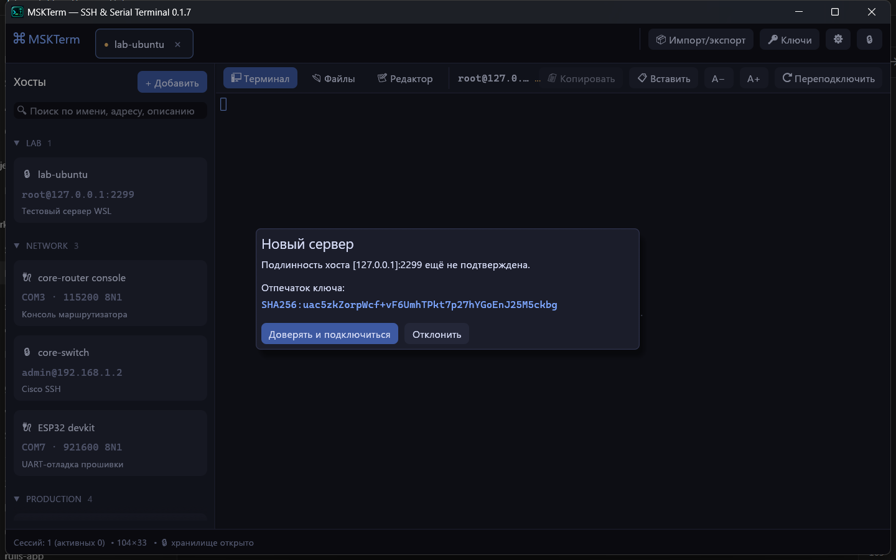

**Connection editor:** name, address and port, login, auth method (password / SSH key / agent), sudo password, key from the vault or a file, jump host, agent forwarding, "files and editor via sudo" mode, group and description. "Save and connect" opens the session right away.

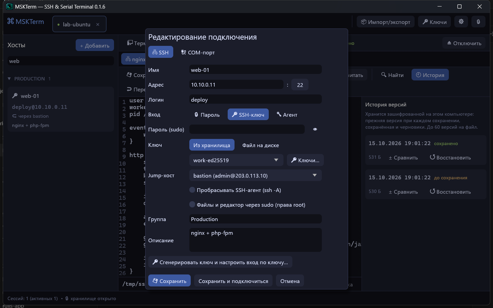

**Host context menu** (right click): connect, edit, set up key login, duplicate, export to file, copy address, delete.

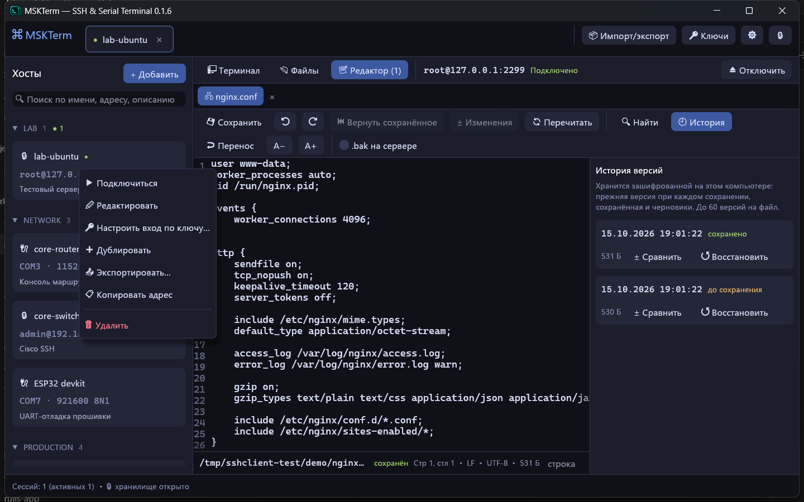

### 3. ANSI/VT100 terminal

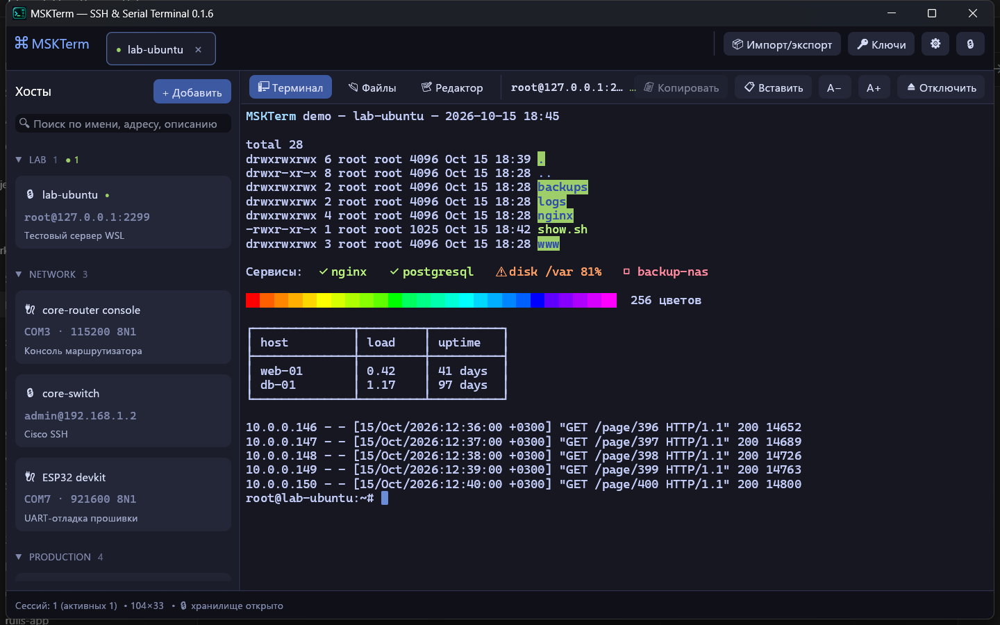

- Full terminal emulation: ANSI colors, 256-color palette and RGB, line-drawing graphics for text UIs (`mc`, `htop`, `nano`, etc.).
- Scrollback up to 10,000 lines; mouse selection and copy.
- `Ctrl+C` copies the selection, or sends `^C` when nothing is selected; `Ctrl+V` pastes. Copy / Paste buttons are on the toolbar too.
- Bracketed paste — multi-line text is not executed line by line by the shell.
- Mouse support for terminal applications (mouse reporting).
- Font size (`A−` / `A+`); the terminal resizes with the window.

### 4. COM / Serial terminal

For USB-UART adapters, router consoles, controllers, microcontrollers and other serial devices.

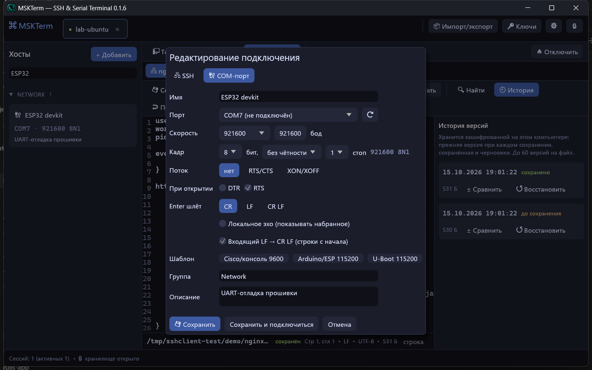

- COM port list with manual refresh; a saved port that is currently absent is marked "not connected".
- Any baud rate plus presets: **Cisco/console 9600**, **Arduino/ESP 115200**, **U-Boot 115200**.
- Data bits (5–8), parity (none / odd / even), stop bits (1 / 2).
- Flow control: none, RTS/CTS, XON/XOFF.
- **DTR** and **RTS** state on open — e.g. turn DTR off so an Arduino/ESP does not reset on connect.
- During a session: toggle **DTR** / **RTS**, **CTS / DSR / CD / RI** indicators, send **BREAK**.
- Local echo, line ending on Enter (`CR`, `LF`, `CRLF`), incoming `LF` → `CR LF`.

**Resilient COM session.** If the USB-UART adapter is unplugged, the device reboots or the port is temporarily busy, the tab stays open and waits for the port **with the same name** to come back, then reopens it. Line control errors are shown instead of killing the session; you are told when typed input had to be dropped. If another program holds the port, MSKTerm tries to show which process it is.

> Reconnection follows the **COM port name**, not the USB VID/PID or serial number. If Windows assigns a different port number after replugging, pick it in the connection settings.

### 5. Dual-pane SFTP file manager

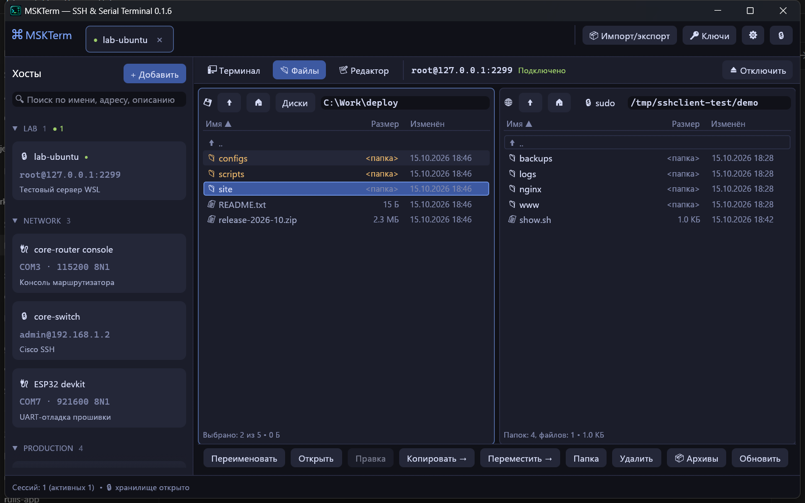

A classic dual-pane file manager: your computer on the left, the server on the right.

- Directory navigation, manual path input, "Drives" button for local drives, go to home folder.
- Sort by name, size and modification date; folders always on top.
- File and folder transfer in both directions, copy and move.
- Drag & Drop from Explorer into the window uploads to the current server folder.
- Name conflicts: skip existing files or overwrite.
- Background operations with progress and cancel in the "Operations" panel.
- Local files are deleted to the Windows Recycle Bin.
- **sudo** mode: server files are read and written as root (requires sudo rights).
- **Permissions (chmod):** from the context menu — octal mode (e.g. `644`, `755`) and rwx checkboxes for owner/group/others; optional recursive apply for directories.
- File context menu, selection and folder totals in the status line.

**Hotkeys:**

| Key | Action |
|---|---|
| `Tab` | Switch pane |
| `Insert` / `Space` | Mark file (Insert also moves down) |
| `Shift+↑↓`, `Ctrl+A`, `Esc` | Select range, select all, clear selection |
| `Enter` / `F3` | Open folder or file |
| `Backspace` | Parent folder |
| `F2` | Rename |
| `F4` | Edit in the built-in editor |
| `F5` / `F6` | Copy / move to the other pane |
| `F7` | New folder |
| `F8` / `Delete` | Delete |
| `Alt+F5` / `Alt+F9` | Create archive / extract on the server |
| `Ctrl+R` | Refresh pane |

When the window is narrow, bottom-bar labels are shortened automatically; the full name with the key is shown in the tooltip.

### 6. Archives right on the server

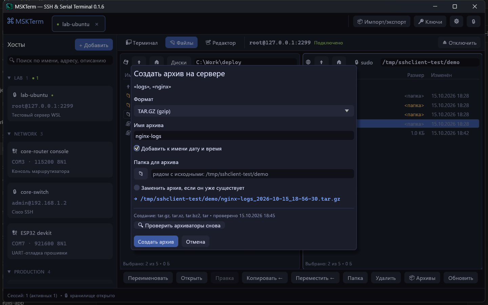

MSKTerm detects which archivers are installed on the server, remembers the result and offers only the available create/extract operations. Formats:

`ZIP` · `TAR` · `TAR.GZ` · `TAR.BZ2` · `TAR.XZ` · `TAR.ZST` · `7Z` · `RAR`

- Choose format, name and destination folder; optionally replace an existing archive.
- **Date and time in the archive name** — a checkbox appends a stamp like `_2026-10-15_18-57-00`, handy for backups: archives sort by time.
- Available formats depend on the tools on the server (`tar`, `gzip`, `bzip2`, `xz`, `zstd`, `zip`, `unzip`, `7z`, `rar`, …); detection can be re-run.
- Packing and extracting run in the background and can be cancelled.

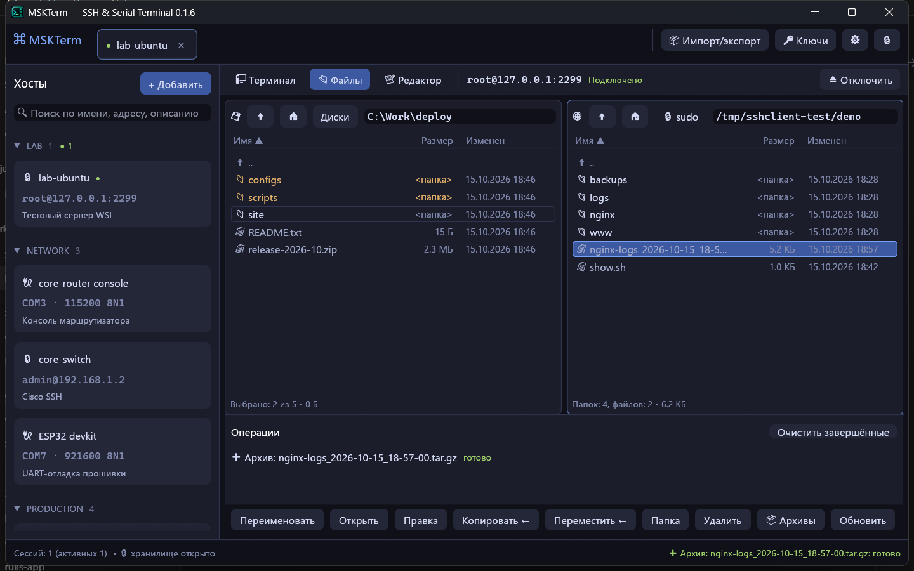

### 7. Built-in editor with version history

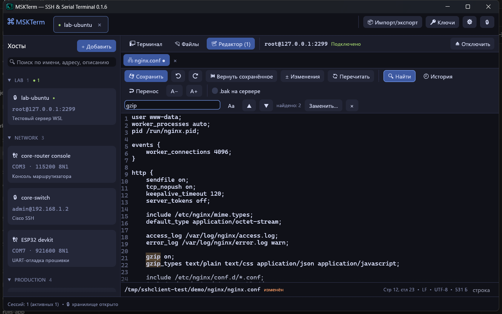

- Edit server files (`F4` in the file manager) and local files; multiple files in tabs.
- Case-sensitive or insensitive search, replace (`Ctrl+F`, `Ctrl+H`), go to line (`Ctrl+G`), Undo/Redo, save with `Ctrl+S`.
- Word wrap, font size, line numbers; the status line shows cursor position, line endings, encoding and size.
- "± Changes" compares the current text with the saved one (diff); "Revert to saved" drops all edits; "Reload" reads the file again.
- External change detection: if the file on the server changed after opening, MSKTerm warns instead of silently overwriting someone else's edits.
- **Encrypted local history**: up to 60 versions per file — the previous version on every save, the saved version and drafts. Any version can be compared with the current text or restored.
- Optional `.bak` next to the server file before the first save.
- Line endings (LF / CRLF) and UTF-8 BOM are preserved.
- Non-UTF-8 files open read-only to avoid corrupting them.
- Editable file size up to **5 MiB**.

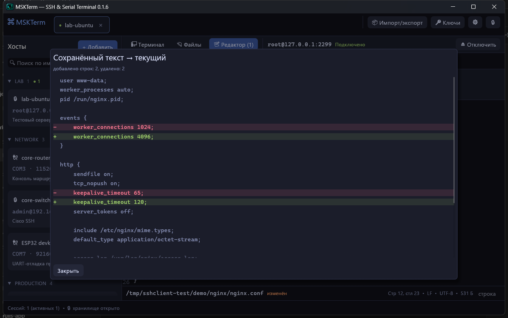

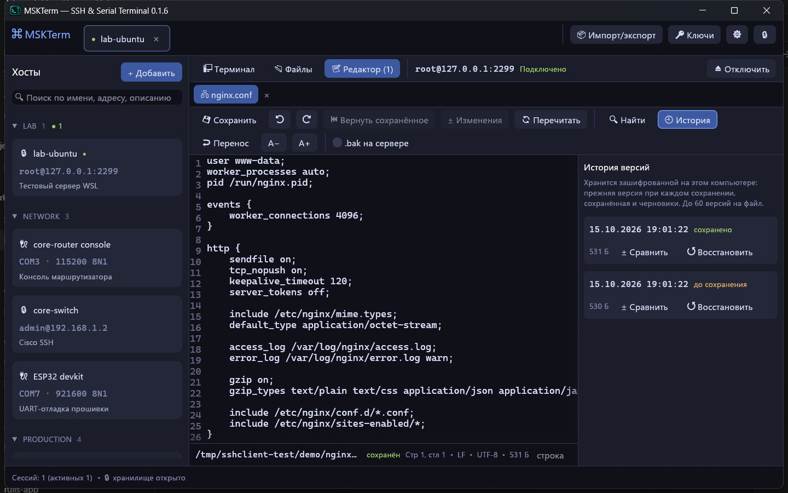

> A `.bak` next to a config may be picked up by a service as an extra config file. Use this option with care in directories like `conf.d` or `sites-enabled`.

### 8. SSH key management

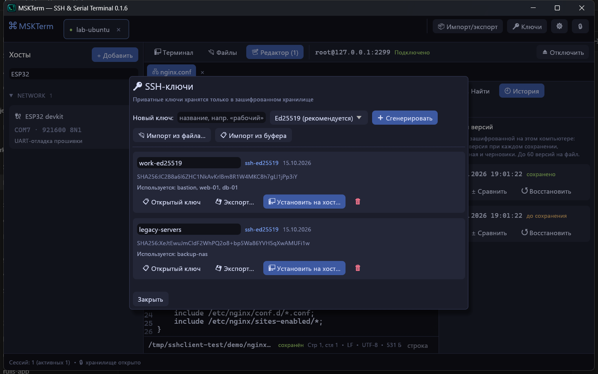

- Generate **Ed25519** (recommended) and **RSA 4096** (for older servers).
- Import private keys from a file or the clipboard: OpenSSH, PEM and **PuTTY `.ppk`**, including passphrase-protected ones.
- Keys are stored only inside the encrypted vault.
- SHA-256 fingerprint and the list of hosts using the key.
- Copy the public key (`authorized_keys` line) with one click; export the private key in OpenSSH format, optionally passphrase-protected.
- "Install on host…" right from the key manager.

**Key login wizard** (from the host context menu or the key manager): generates a new key or takes an existing one, adds the public key to `~/.ssh/authorized_keys`, verifies login with it and optionally switches the server to **key-only** login — with an `sshd` config check and an automatic rollback attempt on failure.

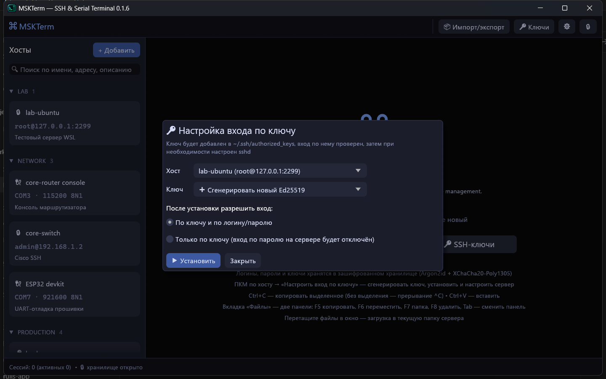

> Changing `sshd_config` is an administrative operation. It needs root/sudo rights; on critical servers keep an independent fallback access method.

### 9. Import and export of connections

**Own encrypted `.msktx` format** ("Import/export" menu):

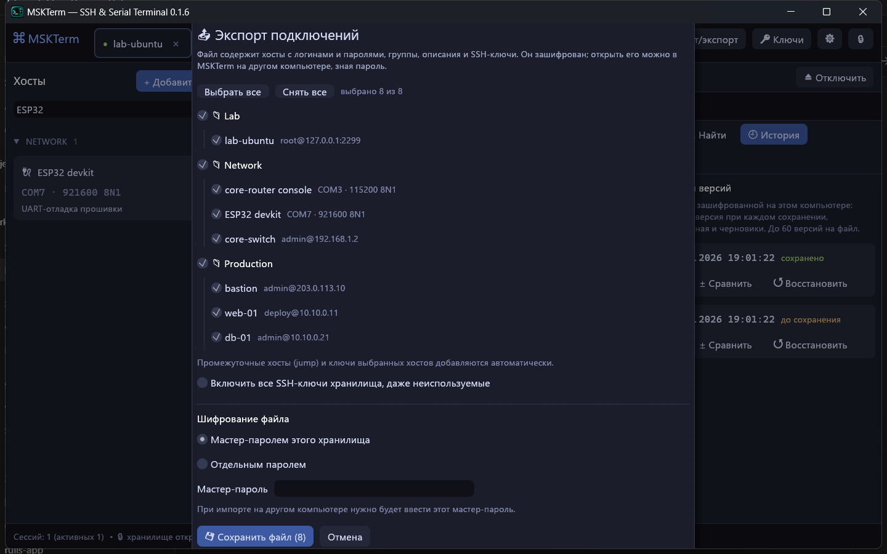

- Export all connections or selected ones — SSH and COM; a single host can be exported from its context menu.
- Used jump hosts and keys are added automatically; optionally all vault keys.
- The file is encrypted with the vault master password or a separate password.
- Importing on another computer shows a preview. Entries are **added**, existing connections are never overwritten; matching keys are reused, links to jump hosts and keys are restored.

**Import from WinSCP:**

- Reads saved sites from the Windows registry or `WinSCP.ini`.
- Transfers SSH hosts, addresses, ports, users, folders (as groups) and saved passwords.
- Imports linked private keys (including `.ppk`), reusing keys already in the vault.
- Preview with duplicate marking.
- FTP, WebDAV and S3 sites are marked unsupported and are not turned into SSH connections.

**WinSCP limitations:** if a master password is enabled in WinSCP, disable it temporarily (WinSCP → Preferences → Security), otherwise the saved passwords cannot be read. WinSCP tunnels are not transferred: such hosts are marked in the preview, the jump host can be set up manually.

### 10. Interface and languages

- Dark theme, connection tabs with "Terminal", "Files", "Editor" workspaces ("COM" for serial).
- Host groups, search, session counter and notifications in the status line.
- **English and Russian UI.** On first start the language follows Windows; switch it on the lock screen or in Settings, no restart needed.
- **Your own language:** in Settings save the translation template, translate the strings and put the `*.json` file into the languages folder ("Languages folder" button opens it). The language appears in the list; untranslated strings are shown in English. Language files are also read from a `lang` folder next to `mskterm.exe`.

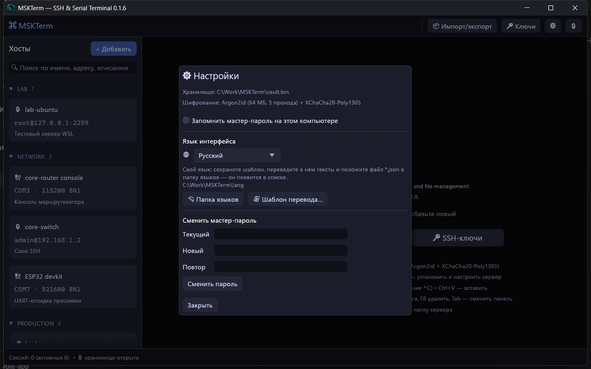

### 11. AI assistant (bring your own key)

Optional helper on the **AI** tab of an active SSH session. The key and settings live in the encrypted vault; secrets and keys are always masked; hosts/e-mails are optional; **IPs are left unmasked by default** (useful for diagnostics — toggle in settings).

- **Bring your own key:** OpenAI, Anthropic, Google Gemini, xAI Grok, DeepSeek, Mistral, Alibaba Qwen, OpenRouter or any OpenAI-compatible endpoint.
- Modes **Observer / Assistant / Agent** — from explaining the screen to step-by-step diagnostics on the server.
- In Agent mode — read-only tools (`read_file`, `service_status`, `failed_units`, `disk_usage`, `memory`, `uptime`, `listen_ports`); steps appear on the right; risky actions need confirmation.
- Context: selected terminal text, the screen, a file from the editor; follow-ups keep chat history (session-only, not saved to disk).
- For models like `gpt-6-luna`, tool calls on Chat Completions set `reasoning_effort: none` automatically.

> Answers come from a third-party model and may be wrong. Always review commands and config changes before running them. MSKTerm does not log you into a vendor account — only what you send with your own key leaves the PC.

## Where MSKTerm helps

| Typical task | In MSKTerm |
|---|---|
| Connect to a server | SSH session from the saved hosts list |
| Go through a bastion | Chain of SSH jump hosts |
| Connection dropped | SSH auto-reconnect with backoff |
| Connect to a UART console | COM terminal with DTR/RTS, BREAK and reconnection |
| Copy a config | Dual-pane SFTP manager with hotkeys |
| Change file permissions | chmod from the context menu |
| Fix a config and roll back | Built-in editor, diff and encrypted history |
| Edit a root-owned file | Files and editor via sudo |
| Make a backup on the server | Archive with date and time in the name, no download |
| Diagnose a service / log | AI agent: read-only tools (logs, units, disk, memory, ports) |
| Set up key login | Generate, install, verify login, configure sshd |
| Move connections to another PC | Encrypted `.msktx` |
| Switch from WinSCP | Import of saved sites and keys |

## Known limitations

- Windows 10 / 11 only.
- COM reconnection follows the previous port name, not the adapter hardware ID.
- SSH auto-reconnect does not run after an explicit Disconnect; a bad-password loop can be stopped with Stop.
- The editor is meant for UTF-8 text files up to 5 MiB.
- Working with files via sudo needs sudo rights and `sftp-server` on the server.
- Archiving requires suitable tools on the server.
- WinSCP import does not transfer tunnels and does not work while the WinSCP master password is enabled.
- Terminal emulation covers common programs but not every possible control sequence.
- AI needs your API key and network access to the chosen provider; some flagship models prefer the Responses API — on Chat Completions, tools may require `reasoning_effort: none` (MSKTerm sets this for Luna/Sol).

## License

**MSKTerm is free for non-commercial use only** — personal, educational, home use and non-profit projects.

- Use in commercial organizations or for profit requires permission from the copyright holder.
- Selling the program, distributing modified versions, decompiling or modifying the executable is prohibited.
- The program is provided "as is", without any warranty. The author is not liable for any damage, data loss or consequences of changing server and device settings.
- The source code is not published.

Full text: [LICENSE](LICENSE). Commercial licensing, bug reports and suggestions: [GitHub Issues](https://github.com/msksrv/MSKTerm/issues).

---

*MSKTerm — SSH, Serial & Files. Everything connected.*

© 2026 MSKSRV. All rights reserved.
