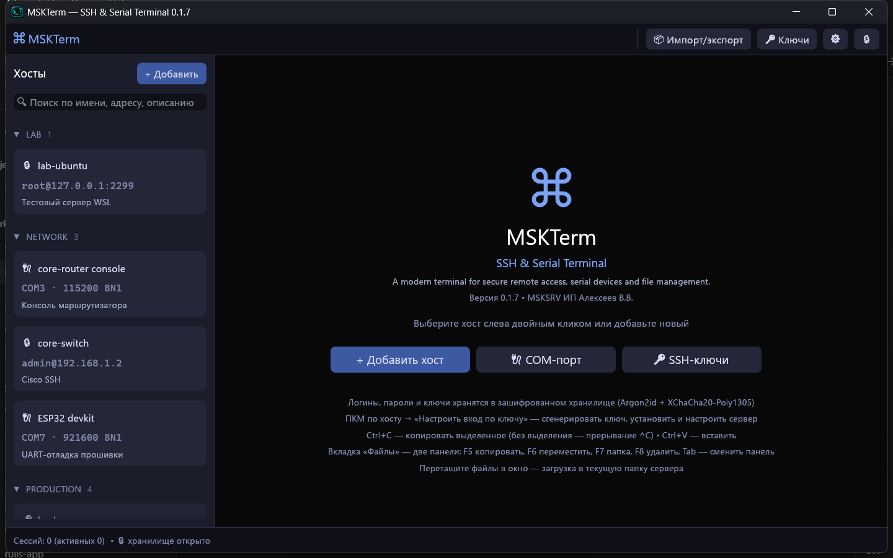

<div align="center">

# MSKTerm

### SSH & Serial Terminal · SFTP · File Manager · Secure Vault

**Один инструмент для серверов, сетевого оборудования и последовательных консолей.**

MSKTerm — настольное приложение Windows для повседневной работы. Подключайтесь к Linux-серверам по SSH, работайте с COM-портами, переносите файлы по SFTP, редактируйте конфигурации и управляйте SSH-ключами — без постоянного переключения между разными программами.

**Версия:** `0.1.7` · **Платформа:** Windows 10 / 11 (x64) · **Лицензия:** бесплатно для некоммерческого использования

**[⬇ Скачать](https://github.com/msksrv/MSKTerm/releases/latest)** · **[English](README.en.md)**

</div>

> **MSKTerm объединяет терминал, файловый менеджер и редактор.** Особенно полезен там, где обычного SSH недостаточно: при настройке маршрутизаторов, работе с UART-консолями, обслуживании серверов через bastion-хосты и исправлении конфигурационных файлов с возможностью отката.



## Зачем нужен MSKTerm

Обычный рабочий процесс часто требует нескольких приложений: SSH-клиента для консоли, отдельной программы для COM-порта, SFTP-клиента для файлов, редактора для конфигураций и утилиты для управления ключами. MSKTerm собирает эти задачи в одном окне с сохранёнными подключениями и вкладками.

Это не просто «терминал с дополнительными кнопками». В программе предусмотрены сценарии, которые важны при реальной эксплуатации: переподключение USB-UART без потери вкладки, предупреждения при изменении удалённого файла, зашифрованная история редактора, доступ к файлам через sudo и управляемая установка SSH-ключей.

## Скачать и запустить

1. Скачайте `mskterm-0.1.7.exe` со [страницы релизов](https://github.com/msksrv/MSKTerm/releases/latest).
2. Проверьте контрольную сумму SHA-256 (указана в описании релиза):
   ```powershell
   Get-FileHash .\mskterm-0.1.7.exe -Algorithm SHA256
   ```
3. Запустите файл. Установка не требуется — это один исполняемый файл.
4. При первом запуске придумайте мастер-пароль: им шифруется хранилище подключений, паролей и ключей.

**Системные требования:** Windows 10 или 11, 64-бит; видеокарта с поддержкой DirectX 12, Vulkan или OpenGL (подходит практически любая современная).

**Где хранятся данные:** `%APPDATA%\SSHClient\config` — зашифрованное хранилище `vault.bin`, известные ключи серверов, история редактора, настройки интерфейса. Чтобы держать данные в другом месте (например, на флешке рядом с программой), задайте переменную окружения `SSHCLIENT_CONFIG_DIR` с путём к нужной папке.

> Файл не подписан цифровой подписью, поэтому Windows SmartScreen может показать предупреждение при первом запуске. Сверьте SHA-256 и нажмите «Подробнее → Выполнить в любом случае».

## Возможности

### 1. Защищённое хранилище и мастер-пароль


Пароли, параметры подключений и приватные SSH-ключи хранятся в одном зашифрованном файле `vault.bin`.

| Компонент | Реализация |
|---|---|
| Шифрование | XChaCha20-Poly1305 |
| Вывод ключа из мастер-пароля | Argon2id |
| Память Argon2id по умолчанию | 64 МиБ |
| Число проходов | 3 |
| Случайная соль | 16 байт |
| Nonce | 24 байта |
| Проверка целостности | Аутентифицированное шифрование AEAD |

- Мастер-пароль запрашивается при запуске; кнопка с замком в правом верхнем углу блокирует хранилище в любой момент.
- По желанию мастер-пароль можно запомнить в диспетчере учётных данных Windows — тогда хранилище открывается без ввода пароля на этом компьютере.
- Смена мастер-пароля в настройках. Если запись нового хранилища не удалась, старый пароль продолжает работать.
- Ключ истории редактора хранится внутри хранилища отдельно, поэтому смена мастер-пароля не уничтожает историю версий.
- Если мастер-пароль забыт, восстановить данные невозможно — кнопка «Забыли пароль?» предлагает удалить хранилище и начать заново.

**Важно:** шифрование не отменяет необходимость использовать стойкий мастер-пароль и защищать сам компьютер. Независимый криптографический аудит не проводился.

### 2. SSH-клиент

- Подключение к SSH-серверам с аутентификацией по паролю, приватному ключу или через SSH-агент.
- Ключи — из зашифрованного хранилища или из файла на диске; поддерживаются ключи, защищённые паролем.
- Поддержка **Windows OpenSSH Authentication Agent**, **PuTTY Pageant** и `SSH_AUTH_SOCK`.
- **Jump hosts / bastion hosts**: подключение через промежуточный сервер по принципу `ssh -J`, включая цепочки хостов.
- **Agent forwarding** (`ssh -A`) для сценариев, где удалённому серверу нужен доступ к ключам локального агента.
- Проверка отпечатка ключа сервера: отдельное подтверждение нового ключа и предупреждение, если ключ изменился.
- Несколько сессий во вкладках; хосты сгруппированы, есть быстрый поиск по имени, адресу и описанию.
- Отключение зависшей сессии срабатывает сразу, даже если сервер перестал отвечать.


**Редактор подключения.** Имя, адрес и порт, логин, способ входа (пароль / SSH-ключ / агент), пароль для sudo, ключ из хранилища или файла, jump-хост, agent forwarding, режим «файлы и редактор через sudo», группа и описание. Кнопка «Сохранить и подключиться» сразу открывает сессию.


**Контекстное меню хоста** (правая кнопка мыши): подключиться, редактировать, настроить вход по ключу, дублировать, экспортировать в файл, скопировать адрес, удалить.


### 3. Терминал с ANSI/VT100


- Полноценная эмуляция терминала: цвета ANSI, 256-цветная палитра и RGB, псевдографика для рамок и интерфейсов текстовых программ (`mc`, `htop`, `nano` и т. п.).
- Прокрутка истории — до 10 000 строк; выделение мышью и копирование.
- `Ctrl+C` копирует выделенный текст, а без выделения отправляет прерывание `^C`; `Ctrl+V` — вставка. Есть и кнопки «Копировать» / «Вставить» на панели.
- Вставка с учётом режима bracketed paste — многострочный текст не выполняется построчно в оболочке.
- Поддержка мыши в терминальных приложениях (mouse reporting).
- Изменение размера шрифта (`A−` / `A+`); размер терминала подстраивается под окно.

**Практический сценарий:** открыть SSH-сессию, поработать в shell и тут же переключиться на вкладку «Файлы» или «Редактор» того же сервера — без повторного подключения.

### 4. COM / Serial Terminal

Для USB-UART адаптеров, консолей маршрутизаторов, контроллеров, микроконтроллеров и другого оборудования с последовательным интерфейсом.


- Список COM-портов с ручным обновлением; сохранённый порт, которого сейчас нет в системе, помечается «не подключён».
- Произвольная скорость передачи и готовые шаблоны: **Cisco/консоль 9600**, **Arduino/ESP 115200**, **U-Boot 115200**.
- Биты данных (5–8), чётность (нет / нечёт / чёт), стоп-биты (1 / 2).
- Управление потоком: нет, RTS/CTS, XON/XOFF.
- Состояние линий **DTR** и **RTS** при открытии порта — например, DTR можно выключить, чтобы не перезагружать Arduino/ESP при подключении.
- Во время сессии: переключение **DTR** / **RTS**, индикаторы **CTS / DSR / CD / RI**, отправка сигнала **BREAK**.
- Локальное эхо, окончание строки при Enter (`CR`, `LF`, `CRLF`), преобразование входящих `LF` в `CR LF`.

**Живучая COM-сессия.** Если USB-UART адаптер извлечён, устройство перезагрузилось или порт временно занят, вкладка не закрывается и ждёт, пока снова появится порт **с тем же именем**, после чего переоткрывает его. Ошибки управления линиями показываются, а не обрывают сессию; программа сообщает, если набранный ввод пришлось отбросить. Если порт занят другой программой, MSKTerm пытается показать, какой именно процесс его удерживает.

> Переподключение ориентируется на **имя COM-порта**, а не на USB VID/PID или серийный номер адаптера. Если после переподключения Windows выдала адаптеру другой номер порта, выберите его в настройках подключения.

### 5. Двухпанельный файловый менеджер SFTP


Классический двухпанельный файловый менеджер: слева — компьютер, справа — сервер.

- Навигация по каталогам, ввод пути вручную, кнопка «Диски» для выбора локального диска, переход в домашнюю папку.
- Сортировка по имени, размеру и дате изменения; папки всегда сверху.
- Передача файлов и каталогов в обе стороны, копирование и перемещение.
- Drag & Drop файлов из Проводника в окно — загрузка в текущую папку сервера.
- Конфликты имён: пропустить существующие файлы или перезаписать.
- Фоновые операции с прогрессом и отменой на панели «Операции».
- Локальные файлы удаляются в корзину Windows.
- Режим **sudo**: файлы сервера читаются и записываются с правами root (нужны права sudo у пользователя).
- Контекстное меню файлов, итоги по выделению и по папке в строке состояния.

**Горячие клавиши:**

| Клавиша | Действие |
|---|---|
| `Tab` | Переключить панель |
| `Insert` / `Пробел` | Отметить файл (Insert — с переходом вниз) |
| `Shift+↑↓`, `Ctrl+A`, `Esc` | Выделить диапазон, выделить всё, снять выделение |
| `Enter` / `F3` | Открыть папку или файл |
| `Backspace` | Папка выше |
| `F2` | Переименовать |
| `F4` | Редактировать во встроенном редакторе |
| `F5` / `F6` | Копировать / переместить на другую панель |
| `F7` | Создать папку |
| `F8` / `Delete` | Удалить |
| `Alt+F5` / `Alt+F9` | Создать архив / распаковать на сервере |
| `Ctrl+R` | Обновить панель |

Если окно узкое, подписи кнопок нижней панели автоматически сокращаются, а полное название с клавишей видно во всплывающей подсказке.

### 6. Работа с архивами прямо на сервере


MSKTerm проверяет, какие архиваторы установлены на сервере, запоминает результат и предлагает только доступные операции создания и распаковки. Форматы:

`ZIP` · `TAR` · `TAR.GZ` · `TAR.BZ2` · `TAR.XZ` · `TAR.ZST` · `7Z` · `RAR`

- Выбор формата, имени и папки для архива; опция замены существующего архива.
- **Дата и время в имени архива** — флажок добавляет к имени метку вида `_2026-10-15_18-57-00`, удобно для резервных копий: архивы сортируются по времени.
- Набор доступных форматов зависит от программ на сервере (`tar`, `gzip`, `bzip2`, `xz`, `zstd`, `zip`, `unzip`, `7z`, `rar` и др.); проверку можно повторить кнопкой.
- Упаковка и распаковка идут в фоне, их можно отменить.


**Преимущество:** чтобы упаковать каталог или логи, не нужно сначала скачивать их на компьютер.

### 7. Встроенный редактор файлов с историей версий


- Редактирование файлов сервера (`F4` в файловом менеджере) и локальных файлов; несколько файлов во вкладках.
- Поиск с учётом регистра и без, замена (`Ctrl+F`, `Ctrl+H`), переход к строке (`Ctrl+G`), Undo/Redo, сохранение `Ctrl+S`.
- Перенос строк, размер шрифта, номера строк; в строке состояния — позиция курсора, окончание строк, кодировка и размер.
- «± Изменения» — сравнение текущего текста с сохранённым (diff); «Вернуть сохранённое» — отменить все правки; «Перечитать» — загрузить файл заново.
- Обнаружение внешнего изменения файла: если файл на сервере поменяли после открытия, MSKTerm предупредит, а не перезапишет чужие правки молча.
- **Зашифрованная локальная история**: до 60 версий на файл — прежняя версия при каждом сохранении, сохранённая версия и черновики. Любую версию можно сравнить с текущим текстом или восстановить.
- Опционально — `.bak` рядом с файлом на сервере перед первым сохранением.
- Тип окончания строк (LF / CRLF) и UTF-8 BOM сохраняются как были.
- Файлы не в UTF-8 открываются только для чтения, чтобы не повредить данные.
- Размер редактируемого файла — до **5 МиБ**.


> `.bak` рядом с конфигурацией иногда может быть прочитан сервисом как дополнительный конфигурационный файл. Для каталогов вроде `conf.d` или `sites-enabled` эту опцию следует применять осознанно.

### 8. Управление SSH-ключами


- Генерация **Ed25519** (рекомендуется) и **RSA 4096** (для старых серверов).
- Импорт приватных ключей из файла или из буфера обмена: OpenSSH, PEM и **PuTTY `.ppk`**, в том числе защищённых паролем.
- Ключи хранятся только внутри зашифрованного хранилища.
- Отпечаток SHA-256 и список хостов, которые используют ключ.
- Копирование открытого ключа (строка для `authorized_keys`) одной кнопкой; экспорт приватного ключа в формате OpenSSH, по желанию с паролем.
- Кнопка «Установить на хост…» прямо из менеджера ключей.

**Мастер настройки входа по ключу** (из контекстного меню хоста или менеджера ключей): генерирует новый ключ или берёт существующий, добавляет открытый ключ в `~/.ssh/authorized_keys`, проверяет вход по нему и, по выбору, переключает сервер на вход **только по ключу** — с проверкой конфигурации `sshd` и попыткой автоматического отката при неудаче.


> Изменение `sshd_config` — административная операция. Нужны права root/sudo, а на критичных серверах разумно сохранять независимый резервный способ доступа.

### 9. Импорт и экспорт подключений

**Собственный зашифрованный формат `.msktx`** (меню «Импорт/экспорт»):


- Экспорт всех подключений или выбранных — SSH и COM; отдельный хост можно экспортировать из его контекстного меню.
- Используемые jump-хосты и ключи добавляются автоматически; при желании — все ключи хранилища.
- Файл шифруется мастер-паролем хранилища или отдельным паролем.
- При импорте на другом компьютере показывается предпросмотр. Записи **добавляются**, существующие подключения не перезаписываются; совпадающие ключи используются повторно, связи с jump-хостами и ключами восстанавливаются.

**Импорт из WinSCP:**

- Чтение сохранённых сайтов из реестра Windows или `WinSCP.ini`.
- Перенос SSH-хостов, адресов, портов, пользователей, папок (как групп) и сохранённых паролей.
- Импорт связанных приватных ключей (в том числе `.ppk`) с повторным использованием уже имеющихся в хранилище.
- Предпросмотр записей и пометка дубликатов.
- Сайты FTP, WebDAV и S3 помечаются как неподдерживаемые и не превращаются в SSH-подключения.

**Ограничения WinSCP:** если в WinSCP включён мастер-пароль, его нужно временно отключить (WinSCP → Настройки → Безопасность) — иначе сохранённые пароли не прочитать. Туннели WinSCP не переносятся: такие хосты помечаются в предпросмотре, jump-хост можно настроить вручную.

### 10. Интерфейс и языки


- Тёмная тема, вкладки подключений с рабочими областями «Терминал», «Файлы», «Редактор» (для COM — «COM»).
- Группировка хостов, поиск, счётчик сессий и уведомления в строке состояния.
- **Русский и английский интерфейс.** При первом запуске язык выбирается по языку Windows; переключить можно на экране разблокировки или в настройках, без перезапуска.
- **Свой язык:** в настройках сохраните шаблон перевода, переведите строки и положите файл `*.json` в папку языков (кнопка «Папка языков» открывает её). Язык появится в списке. Непереведённые строки показываются по-английски. Файлы языков также читаются из папки `lang` рядом с `mskterm.exe`.


## Чем MSKTerm удобен в работе

| Типичная задача | В MSKTerm |
|---|---|
| Подключиться к серверу | SSH-сессия из списка сохранённых хостов |
| Зайти через bastion | Цепочка SSH jump-хостов |
| Подключиться к UART-консоли | COM-терминал с DTR/RTS, BREAK и переподключением |
| Скопировать конфиг | Двухпанельный SFTP-менеджер с горячими клавишами |
| Исправить конфиг и откатить правки | Встроенный редактор, diff и зашифрованная история |
| Отредактировать файл, принадлежащий root | Файлы и редактор через sudo |
| Сделать резервную копию на сервере | Архив с датой и временем в имени, без скачивания |
| Настроить вход по ключу | Генерация, установка, проверка входа, настройка sshd |
| Перенести подключения на другой ПК | Зашифрованный `.msktx` |
| Перейти с WinSCP | Импорт сохранённых сайтов и ключей |

## Известные ограничения

- Программа предназначена для Windows 10/11.
- Переподключение COM ориентируется на прежнее имя порта, а не на аппаратный идентификатор адаптера.
- Редактор предназначен для текстовых файлов UTF-8 размером до 5 МиБ.
- Для работы с файлами через sudo нужны права sudo и установленный `sftp-server` на сервере.
- Архивирование требует подходящих утилит на сервере.
- Импорт WinSCP не переносит туннели и не работает при включённом мастер-пароле WinSCP.
- Эмуляция терминала покрывает распространённые программы, но не каждую возможную управляющую последовательность.

## Лицензия

**MSKTerm распространяется бесплатно только для некоммерческого использования** — личного, учебного, домашнего, для некоммерческих проектов.

- Использование в коммерческих организациях и для извлечения прибыли — только по согласованию с правообладателем.
- Запрещены продажа программы, распространение изменённых версий, декомпиляция и модификация исполняемого файла.
- Программа предоставляется «как есть», без каких-либо гарантий. Автор не несёт ответственности за возможный ущерб, потерю данных или последствия изменения настроек серверов и оборудования.
- Исходный код не публикуется.

Полный текст — в файле [LICENSE](LICENSE). По вопросам коммерческой лицензии, ошибок и предложений — [GitHub Issues](https://github.com/msksrv/MSKTerm/issues).

## Бренд

**MSKTerm** — проект в экосистеме **MSKSRV**.

**Идея:** меньше переключений между инструментами, больше контроля над подключениями, файлами и устройствами.

---

*MSKTerm — SSH, Serial & Files. Everything connected.*

© 2026 MSKSRV Все права защищены.
